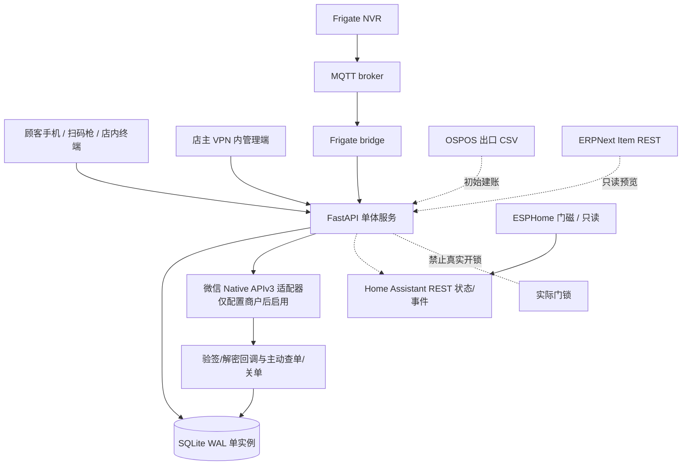

# OpenRetail V2 架构与数据所有权

## 订单与库存状态

- `products.stock` = 当前账面实物库存；`reserved_stock` = 已占用未结算数量；`available_stock = stock - reserved_stock`。
- 创建订单 `PENDING` 时使用 SQLite `BEGIN IMMEDIATE` 原子预留；并发最后一件只允许一个订单预留成功；取消或未发起外部支付的订单超时释放预留。
- 库存权威是本仓库 SQLite。OSPOS / ERPNext 不得并行扣减同一库存。
- `PENDING → PAYMENT_PENDING` 有两条路。微信：发起真实商户请求前就占住预留；超时也不能本地释放，直到商户查单/关单。模拟：`payment_reference` 以 `mock:` 开头，到期由本地计时器释放，不访问 `api.mch.weixin.qq.com`。
- `PENDING` 或本地 `mock:` 的 `PAYMENT_PENDING → PAID` 使用 `MOCK_NOT_REAL_MONEY` 且 `verified=0`。微信 `PAYMENT_PENDING → PAID` 仅已验签的成功回调或主动查单。支付成功与库存扣减同一事务，流水 `PAID_SALE`。模拟退款把状态改为 `REFUNDED` 并写 `MOCK_REFUND_RESTORE`，不调用机构退款。
- 异常订单 `PAYMENT_REVIEW` 不能冒充成功销售；仍需人工进行账务与退款处理。Webhook 去重以事件 ID 与订单已结算交易号双重防护。
- 首次 CSV 商品导入后，产生任何订单将锁定全量库存覆盖。运营时应采用调整/补货接口或经验证的单权威 POS 同步适配器。

## 已知限制

- SQLite 适合单店单服务小规模部署；不是多店多节点高可用数据库。要跨门店部署时另做数据库与消息队列迁移验证。
- Home Assistant 只用于显示与设备消息，不参与财务事务。所有正式门禁行为目前被禁止。
- Frigate person 事件不可推断商品丢失或偷盗行为。
- 微信 Native 适配器适合双设备收款场景；对手机同机支付需接官方 H5/JSAPI 或小程序支付，并取得商户权限、配置回调及完成实测。
- 管理账户目前单店单管理员，缺少多人角色、细粒度授权与生产级告警值班调度。
